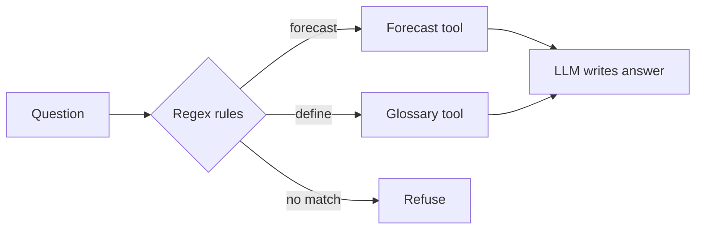
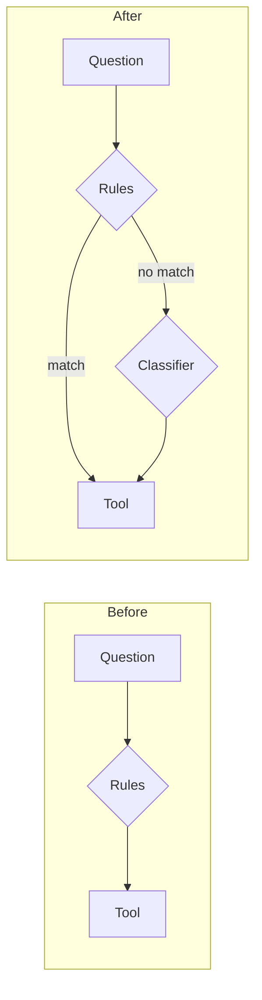
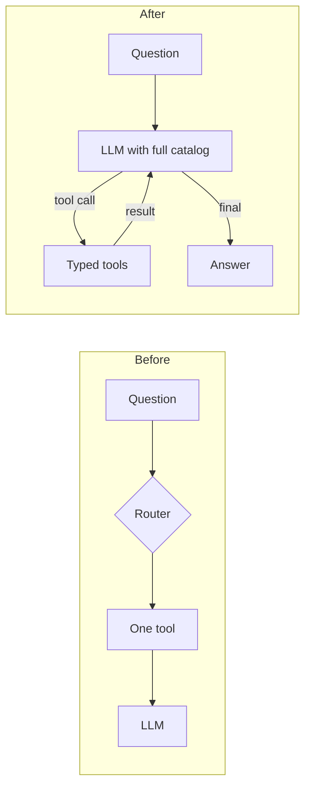
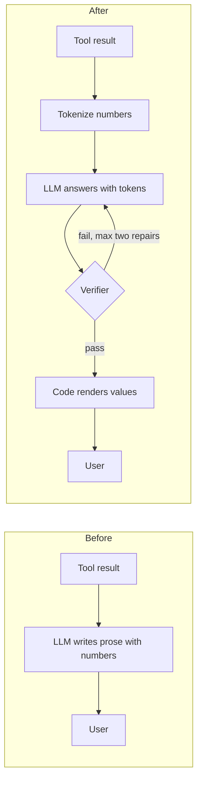
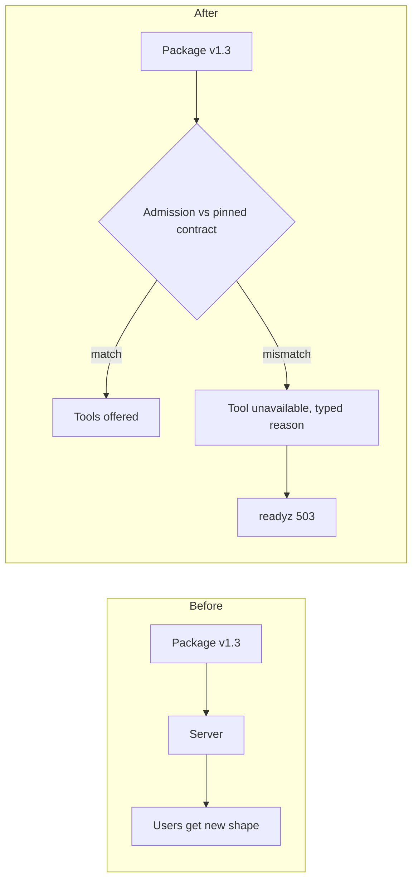
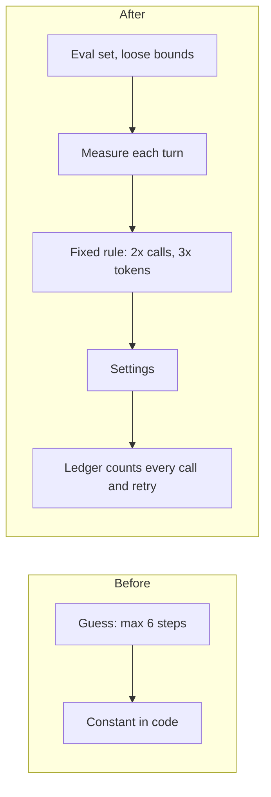
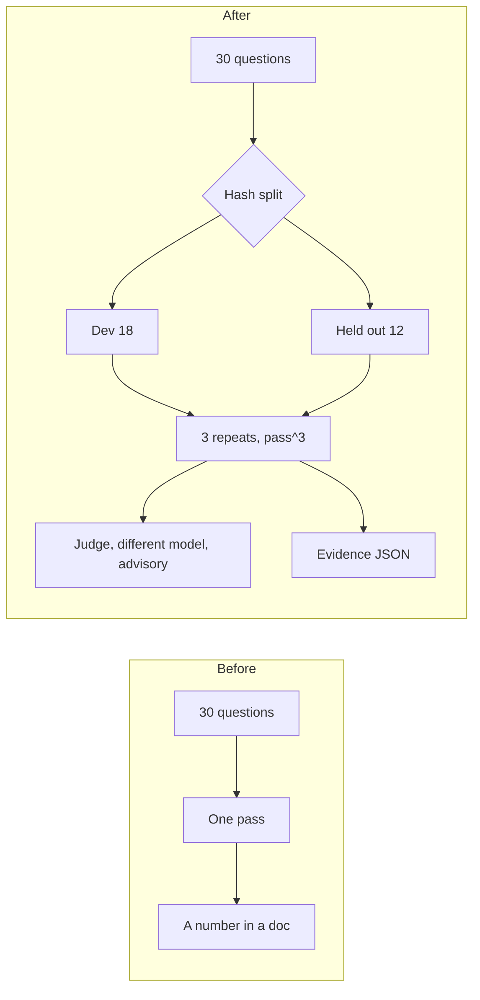
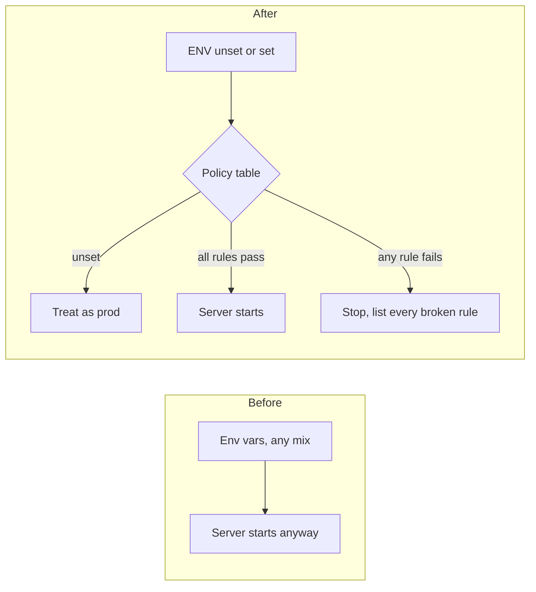

# How AI assistant architecture evolves, and why

Most AI assistants I have built, or seen built, go through the same eight stages. Each stage fixes a real
problem the last one left behind. Each one also costs something. This lesson walks through all eight, in order,
so you can tell which stage your own system is in and what the next honest step is.

Files in this folder:

- [CHEATSHEET.md](CHEATSHEET.md): the whole lesson on one page.
- [INTERVIEW_QA.md](INTERVIEW_QA.md): 14 interview questions with spoken answers.
- `verifier_demo.py` and `test_verifier_demo.py`: stage 4 in 60 lines. A verifier that rejects a number the
  model typed by itself.

```bash
python arch_evolution/verifier_demo.py
python -m pytest arch_evolution -q
```

## About the numbers

Every number here comes from my own repos, run on my machine. Many of them come from an **offline scripted
model**: a deterministic, keyword-based fake model that lets CI run without an API key. Offline numbers measure
the plumbing (routing, checks, refusals), not the quality of a real LLM. I label them every time.

The one number to remember is this. On 46 hard router labels, the old rules + classifier router scored
**95.7%**. The new agent loop, driven by the keyword-only offline model, scored **69.6%**. The new architecture
was "better" and still lost. **Architecture alone is not a win. The model and the evals carry it.**

## The journey at a glance

| # | Stage | Problem it fixes | Main cost |
|---|---|---|---|
| 1 | Keyword / regex router | none yet: it is the starting point | every new phrasing needs a new rule |
| 2 | Intent classifier | rules miss paraphrases | needs labelled data, still a separate brain |
| 3 | One agent loop with typed tools | router and model disagree; wrong routes are silent | routing quality becomes model quality |
| 4 | Deterministic verification, code renders numbers | the model can still invent a number | one more tool to learn; answers read like reports |
| 5 | Pinned tool contracts, version admission | schemas change under users silently | a reviewed diff for every schema change |
| 6 | Bounds from data | step limits picked by feel | must re-measure when the model changes |
| 7 | Honest evals | one pass hides flakiness and over-fitting | more eval time, real money with a live model |
| 8 | Fail-closed config | a forgotten setting makes prod weaker | the laptop setup needs one explicit line |

---

## Stage 1. Keyword and regex router

**The problem.** You have three or four tools and a deadline. You need the assistant to work today.

**The change.** A few `if "forecast" in question` rules, or regular expressions, pick the tool. The LLM only
writes the final sentence.



**The trade-off.** Fast, cheap, easy to test, and fully predictable. But it only knows the phrasings you
thought of. In my project, rules alone got 39 of 46 hard labels right (84.8%), and only 57.1% of the document
questions, because people ask for documents in many ways.

**When NOT to do it.** When users type free text you cannot predict. When a wrong route is silent: the model
never sees the question in a position to fix it.

## Stage 2. Intent classifier

**The problem.** Rules miss paraphrases. You keep adding rules, and they start to fight each other.

**The change.** Put a small classifier (naive Bayes, logistic regression, or an embedding model) behind the
rules. Rules fire first; the classifier handles what they miss.



**The trade-off.** It works. Rules + classifier went from 84.8% to **95.7%** (44 of 46) on my labels, and
document recall went from 57.1% to 85.7%. In a separate serving benchmark, a rules + classifier router cost 28%
less than always using the large model and cut p50 latency from 4.80 s to 2.62 s, but 15% of queries landed on
a model that was too small. Cheaper and faster, with a real error rate.

The cost: you need labelled training data, kept apart from your test data. And the router is still a second
brain that can disagree with the model.

**When NOT to do it.** When you have no labelled examples. When the tool list changes every week, because each
change means retraining.

## Stage 3. One agent loop with typed tools

**The problem.** Two brains. The router decides before the model sees the question. When the router is wrong,
the model cannot recover, and every new tool means new rules and new training data.

**The change.** Delete the router from the request path. Give the model the full catalog, including document
search and a way to decline, with typed parameters and clear descriptions. Code only runs tools, checks and
renders. I added a CI check that fails if the agent code imports `re`, so nobody quietly brings the keyword
router back.



**The trade-off.** Routing quality is now model quality. With the keyword-only offline model, the agent scored
**69.6%** on the same 46 labels where the old router scored 95.7%. On the easier 30-question end-to-end set,
both scored 30/30 offline. So I kept the old router as a **measured baseline** in the evals, instead of
deleting it. That gap is the number I watch when I switch to a real model.

**When NOT to do it.** When your model is weak or cheap and your intents are few and stable. When you cannot
afford to measure the agent against the router. Deleting the router without a baseline is a vibes decision.

## Stage 4. Deterministic answer verification, and code renders numbers

**The problem.** The prompt says "only use numbers from tools". Nothing enforces it. The model picks its own
rounding and units, and sometimes it invents a number that looks right.

**The change.** Two parts.

1. The answer is a **tool call** (`submit_answer`) with a schema, not free prose.
2. The model never types digits. Every number in a tool result gets a token, like `c1.n4`. The answer uses
   tokens. A verifier checks with set lookups: no digits in the text, every token exists in this run, every
   quote is an exact span of a retrieved passage. Then **code** renders the real value with the label and unit
   from the tool's output schema.

A failed check comes back as a structured repair. After two repairs the turn ends as `incomplete`, never as an
unchecked answer. See `verifier_demo.py` in this folder.



**The trade-off.** One more tool and a token syntax for the model to learn, and a weak model will burn repairs.
Answers read more like a report than a chat. And the floor is a floor: it proves where each number came from,
not that the answer is relevant. An LLM checker could judge relevance, but it is slow and can be wrong in the
same way as the model it checks.

**When NOT to do it.** When the assistant does not state facts or numbers (a brainstorming helper, a writing
tool). When there are no structured tool results to ground against.

## Stage 5. Pinned tool contracts and version admission

**The problem.** A model package changes a field name or a unit. The agent and every downstream user get the
new shape with no warning. Nothing errors.

**The change.** Commit a snapshot of every tool schema, with versions and a hash, to git. CI regenerates it and
fails on any diff. At start-up, each tool package is **admitted** by policy: dev accepts the pinned version or a
pre-release of it; staging and prod need the exact version. A package that fails is marked unavailable with a
typed reason. The other tools keep working, and the readiness check returns 503 with the reasons.



**The trade-off.** Every schema change becomes a reviewed diff with a regenerated file. That is a small chore,
and it is the point.

**When NOT to do it.** In a one-person prototype where you own every tool and every caller. Add it the day
someone else depends on your output.

## Stage 6. Bounds and budgets from data

**The problem.** One constant, "max 6 steps", picked by feel. Retries and failovers inside the HTTP adapter are
hidden, so nobody knows what a turn really costs.

**The change.** Make every bound a setting: tool calls per step, model calls per turn, tokens, spend. Count
everything in a per-turn ledger, including retries. Then run the eval set with loose bounds, measure, and apply
a fixed rule. My rule: 2x the largest call counts, plus 2 spare model calls, and 3x the tokens.

On my offline run (38 runs, scripted model): at most 3 model calls, 1 tool call per step, 1 repair and about
4,500 tokens. That gave defaults of 5 model calls, 2 calls per step, and 14,000 tokens.



**The trade-off.** Bounds from an offline model are tight, because a scripted model is efficient. A real model
explores more. You must re-derive the bounds when the model changes.

**When NOT to do it.** Before you have an eval set. Bounds from data need data.

## Stage 7. Honest evals

**The problem.** One pass per question. With a real model, one pass hides flakiness. Tuning on the whole set
hides over-fitting. And a result in a document cannot be traced to the run that produced it.

**The change.**

- **Repeats.** Run each question 3 times. Report pass@1 (the average) and pass^3 (a question counts only if all
  3 pass). Gate on pass^3. List the flaky ids.
- **Held-out split.** A fixed hash of each id puts about a third aside (12 of 30 in my set). Tune on the rest.
- **An independent judge.** An optional LLM judge that refuses to start if it is the same model as the one
  under test, with a small hand-labelled calibration file. It is advisory and never decides CI.
- **Evidence files.** Every run writes a JSON with the commit, the model ids, a pinned clock, hashes of the
  scenario files and every result. A claim points to a file.



**The trade-off.** Offline everything is deterministic, so pass^3 equals pass@1 (30/30 on both splits) and the
flaky list is empty. The machinery only earns its keep with a live model. Three repeats triple the eval time:
seconds offline, real money live.

**When NOT to do it.** Do not skip it. If the budget is tight, shrink the set before you drop the held-out split.

## Stage 8. Fail-closed config

**The problem.** Any mix of settings starts the server. A forgotten variable can quietly turn on the offline
model, or a pinned demo clock, in production.

**The change.** One environment variable: `dev`, `staging` or `prod`. Anything else stops the server. **Unset
means prod**, the strictest row. One policy table says what each environment allows (pinned clock: dev only;
offline model: not in prod; exact versions outside dev; minimum token length). The check runs before anything
else starts and reports every broken rule at once.



**The trade-off.** The laptop quick start needs one explicit `ENV=dev` line. In return, a mistake can only
make the server stricter.

**When NOT to do it.** It is cheap enough to do early. The only reason to wait is a throwaway notebook.

---

## What I would tell my younger self

1. Each stage is a response to a real failure. Do not jump to stage 8 on day one; jump when the failure shows up.
2. When you remove a component, keep it as a **baseline** in your evals. My router "lost" the architecture
   argument and still beat the agent 95.7% to 69.6% on a weak model.
3. Put checks in code, not in the prompt. "Only use tool numbers" in a prompt is a wish. A verifier is a rule.
4. Label every number with where it came from. Offline numbers measure plumbing, not intelligence.
5. Related days: Day 3 (agents), Day 4 (MCP), Day 6 (evals), Day 12 (guards), Day 16 (tool policy),
   Day 17 (versioned contracts).
