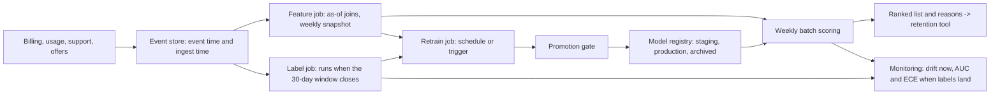

# Design 5: churn prediction with a retraining loop

**Prompt**: "A subscription service wants to know which subscribers are likely to cancel in the next 30 days, so the
retention team can contact them or make an offer. The model must stay good as the market changes."

## 1. Clarify (assumed answers)

- 2 M active subscribers, billed monthly. About 3% cancel each month.
- The retention team can contact about 20,000 people a week. Offers cost money.
- Scoring once a week in a batch is enough. No real-time need in v1.
- The label is "cancelled within 30 days of the score date". So it is known only 30 days later.
- Personal and billing data: no protected attributes as features, and offers must be fair across groups.

## 2. Requirements and estimates

- Functional: a weekly churn probability per subscriber, a ranked contact list that fits team capacity, and the
  top reasons for each person.
- Non-functional: point-in-time correct features, calibrated probabilities (they feed a money decision),
  reproducible scores (model version plus feature snapshot), retraining with no manual steps, and a gate that blocks
  bad models.
- Storage (estimate): 2 M rows x 200 features x 4 bytes = 1.6 GB per weekly snapshot; two years of weekly
  snapshots is about 170 GB.
- Compute (estimate): scoring 2 M rows with gradient-boosted trees takes minutes on one machine. A retrain on a year
  of monthly snapshots (about 24 M rows) takes tens of minutes. Training is cheap, which shapes the retraining policy.
- Positives: 3% of 2 M is 60,000 churners a month. Imbalanced, but not extreme.

## 3. Data and labels

- Sources: billing (plan, price, failed payments), product usage (sessions, minutes), support tickets, account facts
  (tenure, contract, region), and the log of retention offers already made.
- **Label window**: score date t, label 1 if the subscriber cancels in (t, t + 30 days]. Decide early whether a
  failed card (involuntary churn) counts. It has different causes, so it may need its own model.
- **Point-in-time features**: use only data that was known at t, by ingest time, not event time. A support ticket
  logged at 23:59 but loaded at 02:00 the next day was not known at midnight.
- **Rows**: one row per subscriber per snapshot. Rows of the same person are correlated, so split by time, and group
  by subscriber inside the training window.
- **Offers change outcomes**: someone who got a discount and stayed is not a clean negative. Log every offer, and keep
  a small random control group (say 5%) that never gets offers. It gives clean labels and measures what offers do.

## 4. Boxes

## 5. Deep dive: imbalance, calibration and the threshold

- **Do not rebalance by default.** At 3% positives, gradient-boosted trees with log loss learn fine. Watch PR-AUC
  and lift in the top decile, not accuracy.
- **Class weights and oversampling distort probabilities.** The ranking can stay almost the same while the scores
  stop meaning "chance of churn". In
  [mlops-model-lifecycle](https://github.com/Avinash186200/mlops-model-lifecycle) (synthetic data), a candidate
  trained with `class_weight=balanced` kept an AUC of 0.803, but its expected calibration error (ECE) was 0.214,
  against 0.011 for the production model. The gate rejected it. It also missed the AUC bar (-0.0025 against the
  +0.005 required), but only the calibration check showed what actually broke.
- **Why calibration matters here**: contact a subscriber when p(churn) x P(offer works) x value saved is greater than
  the cost of the offer. An inflated p sends offers to people who would have stayed.
- If you must reweight (a very rare class), recalibrate afterwards with isotonic regression or Platt scaling, fitted
  on a later time slice, not on the training rows.
- **Threshold by capacity, not 0.5**: take the top 20,000 by expected value each week. Report precision at that
  capacity.
- **The better target is uplift**: who stays because of the offer. People who leave anyway, or stay anyway, waste
  offers. Uplift needs the random control group, so log it from day one.

## 6. Deep dive: retraining policy and the promotion gate

- **Two policies**: retrain on a schedule (monthly), or retrain when drift or performance alerts fire.
- **Evidence**: the same repo simulates 18 served months, with one planted feature shift and one planted concept
  shift. Mean AUC: never retrain 0.792, drift-triggered 0.808, monthly 0.815. Monthly ran 17 retrains, and the gate
  rejected 11 of them because they were no better than production.
- **Rule I use**: if training is cheap, retrain on a schedule and let the gate decide. Use drift monitoring to explain
  changes and catch broken feeds. If training is expensive or needs a review, trigger on alerts and accept the delay.
- **The gate** (all checks must pass, on a holdout month that neither model trained on): beat production AUC by at
  least 0.005, ECE at most 0.05, and the feed passes the schema checks. I would add: no key segment (plan, region,
  tenure band) loses more than a set margin.
- **Training window**: a rolling window of recent labelled months. Short windows adapt faster but are noisier. Pick
  the length with a backtest, not by habit.
- **Release**: score the candidate in shadow for one week and compare score distributions, then promote. Rollback is
  one registry call to the previous version.

## 7. Evaluation and monitoring with late labels

- Offline: time-based split with a gap as long as the label window. AUC and PR-AUC for ranking, ECE and Brier score
  for probabilities, precision at capacity for the business.
- Three live signals: feature drift (PSI per feature, no labels needed), score drift (PSI on scores, and the share
  of people above the contact line), and real performance (AUC, ECE), which arrives one label window late.
- **Drift is not damage.** In the repo, PSI on usage jumped to 1.017 the month usage fell, and AUC did not drop.
  Every candidate trained on the new data over months 9 to 13 failed the gate.
- **Damage without drift.** A planted concept shift (a cheaper rival plan changed what the features mean) did not move
  feature distributions. The drift-triggered policy caught it only through the performance alert, four months late,
  because labels arrive a month late and the loss had to build up past the alert line.
- **Score PSI can stay quiet**: it peaked at 0.191, under the 0.2 alert line, while the churn rate moved from about
  17% to about 25%.
- Shorten the wait with proxy labels: "turned off auto-renew" or "visited the cancel page" arrive in days.

## 8. Failure modes

- **Leakage**: a feature built after the score date ("support calls this month" computed at month end). The backtest
  shines and live results fall. Defence: as-of joins on ingest time, and a no-signal run. In
  [ecommerce-return-prediction](https://github.com/Avinash186200/ecommerce-return-prediction), logistic regression
  scored a test AUC of 0.679 with signal and 0.501 when the data had no signal (returns independent of every
  feature); a CI test enforces it.
- **Feedback loop**: the model picks who gets offers, offers change outcomes, and the next model learns from that.
  The control group breaks the loop.
- **Broken feed**: a usage source stops, features become zero, and everyone looks like a churner. Freshness checks
  block scoring, and the tool keeps last week's list.
- **Base-rate shift**: ranking holds but probabilities drift. Monitor ECE by score bucket, and recalibrate on a
  recent slice without a full retrain.
- **List churn**: a new model every month reshuffles who is called. The minimum gain in the gate stops pointless
  releases.

## 9. Trade-offs and v1

- v1: monthly snapshots, gradient-boosted trees with a logistic regression baseline, weekly batch scores, a
  capacity-sized list by expected value, monthly retrain through the three-check gate, PSI plus delayed AUC and ECE
  dashboards, and a 5% no-offer control group.
- Later: an uplift model, event-triggered scoring (cancel-page visits), segment models only if one segment fails, and
  a shared feature store once a second model needs the same features.
- Biggest trade-off: scheduled retraining spends compute to react to a concept shift; drift-triggered retraining is
  cheaper but late.

## What most candidates miss

- The label is a window that closes late, so performance monitoring is always one window behind.
- With a capacity threshold, class weights add little to the ranking, and they break the probabilities the decision
  needs.
- Retention offers contaminate future labels unless a control group exists.
- A drift alert is not a retrain order. The gate decides.
- Point-in-time means "known at", not "happened at".

## Likely probes

- "Why not retrain whenever drift fires?" Drift and damage are different things. In mlops-model-lifecycle, PSI hit
  1.017 with no AUC loss, and a concept shift hurt AUC with no feature drift. Drift explains and catches broken
  feeds; delayed AUC and the gate decide.
- "Only 3% of subscribers churn. Do you oversample?" Not by default. Oversampling and class weights inflate the
  probabilities. In the repo, class weights kept AUC at 0.803 but pushed ECE from 0.011 to 0.214. If I must
  reweight, I recalibrate on a later time slice.
- "Labels take 30 days. How do you know the model is fine today?" Feature and score drift today, proxy labels within
  days, and full AUC and ECE when the window closes. I state the lag and size it.
- "How do you pick the training window?" A backtest: train on N recent months, test on the next one, for several N.
  Short windows react to a concept shift faster but are noisier.
- "How do you prove the backtest does not leak?" As-of joins on ingest time, a time split with a gap as long as the
  label window, and a no-signal run. In ecommerce-return-prediction, AUC fell from 0.679 to 0.501 on no-signal data.
- "The retention team says the list changes too much." Measure week-to-week overlap of the top of the list, require
  a real gain at the gate, and promote at most once a cycle.
