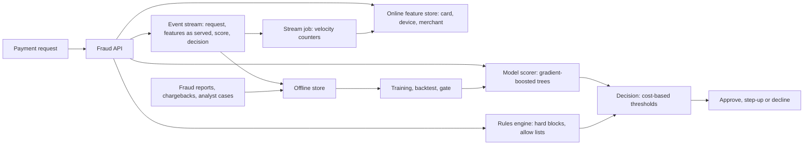

# Design 6: real-time card fraud scoring

**Prompt**: "For every card payment, decide within 100 ms whether to approve it, decline it, or ask the cardholder
for an extra check (a one-time code)."

## 1. Clarify (assumed answers)

- 50 M payments a day, with a peak hour about 5x the average.
- About 1 payment in 1,000 is fraud. Fraud is a larger share of the money, because fraudsters favour big payments.
- The fraud check has 100 ms at p99. The whole payment flow has more, but this is our slice.
- Actions: approve, decline, step-up (one-time code or in-app confirmation), or approve and queue for review.
- Labels: customer fraud reports arrive in days; chargebacks arrive over weeks, some after 60 days or more.
- Costs: a missed fraud loses the amount plus fees. A false decline loses the sale and annoys a good customer, who
  may stop using the card. A step-up costs a little friction; some people give up.

## 2. Requirements and estimates

- Functional: a score and a decision per payment, reason codes for declines, an analyst queue, and rules analysts can
  change in minutes.
- Non-functional: p99 under 100 ms, the same feature values in training and serving, an audit record of every
  decision (features, model version, rules hit), and safe behaviour when a dependency is slow.
- RPS (estimate): 50 M / 86,400 = about 580 on average; x5 at peak = about 3,000.
- In flight (estimate): 3,000 RPS x 0.05 s average = 150 requests at once (Little's law).
- Latency budget (estimate): network and parsing 10 ms, online feature reads 20-30 ms in parallel, model 5-10 ms
  (a few hundred trees), rules 5 ms, decision 5 ms, logging asynchronous, the rest headroom.
- Storage (estimate): about 100 features x 8 bytes = about 1 KB per card; 200 M cards = about 200 GB in the online
  store before replicas. The decision log is about 50 GB a day at 1 KB per payment.

## 3. Data and labels

- Payment event: amount, merchant, merchant category, country, channel (in store or online), device, IP, time.
- Features: velocity (payments per card in the last 1 minute, 1 hour, 24 hours), amount against the card's usual
  amount, first payment at this merchant, distance and time since the last payment, smoothed merchant fraud rate,
  device seen before, cards seen on this device in 24 hours.
- **Label maturity**: a payment from yesterday with no fraud report is not "legit" yet. Train on payments old enough
  that most labels have arrived (say 60 days), and check how complete labels are by age.
- **Declined payments get no label.** You never learn whether they were fraud. Send a small random share of
  would-be declines to step-up instead; the step-up result becomes a label.

## 4. Boxes

## 5. Deep dive: online/offline parity

- **The classic bug**: training features come from batch SQL over the warehouse; serving features come from a
  streaming job. Small differences (window edges, time zones, late events, counting the current payment or not) make
  a model that shone offline weaker online.
- **Fix 1, log what you served**: write the exact feature values used at decision time to the event stream, and train
  on those. Parity by construction. The cost: a new feature needs weeks of logging, or a careful backfill.
- **Fix 2, one definition**: define each feature once and compile it to both batch and streaming (a feature store).
  Then replay a day of events through the streaming path and compare with batch values; fail the release if more
  than a tiny share differ beyond tolerance.
- **Point in time**: "payments in the last hour" excludes the current payment and anything after it. Training uses
  as-of joins on event time.
- **Velocity counters**: per-minute buckets in a key-value store, summed at read time, so a read is a few lookups.

## 6. Deep dive: extreme imbalance and cost-weighted thresholds

- At 0.1% fraud, ROC-AUC is high for almost any model and says little. Use PR-AUC, fraud caught at a fixed false
  decline rate (for example 1 in 1,000 good payments), and the share of fraud money caught.
- **Downsampling**: keep, say, 1 in 20 good payments to speed up training. Then correct the probability: with a keep
  rate s, p = s x q / (s x q + 1 - q), where q is the model's output. Or recalibrate on a recent, untouched slice.
- **Threshold by cost, per payment**: approving costs p x A (A = amount plus fees); declining costs (1 - p) x C, where
  C is the cost of a false decline. Decline when p > C / (A + C). So a large payment is declined at a lower score than
  a small one.
- **Three bands, not one cut**: approve below the low line, step-up in the middle (cheap friction), decline above the
  high line. Set the review queue line by analyst capacity.
- **All of this needs calibrated scores.** A threshold in money terms on uncalibrated scores is a guess.

## 7. Rules plus model

- **Rules** do three things the model cannot: hard policy (card reported stolen, blocked merchant), reaction in minutes
  to a new attack while labels are weeks away, and allow lists.
- **The model** generalises and catches patterns no rule names.
- **Order**: hard blocks first, then the model with cost-based bands, then a few rules that can step up but never
  silently approve a high score.
- **Rule hygiene**: every rule has an owner, an expiry date and its own precision on a dashboard. Old rules pile up
  and decline good customers.

## 8. Evaluation and release

- Backtest walks forward in time: train on mature labels up to a date, test on a later mature window, repeat for
  several windows. Never split randomly: one fraud ring uses many cards, and a random split puts it on both sides.
- Metrics at the operating point: fraud money caught, false declines per 1,000 good payments, step-up rate, and p99
  latency on a replay.
- Gate: catch more fraud money at the same or lower false-decline rate, on each key segment (in store, online, high
  value), with latency and calibration inside bounds.
- Release: shadow first (score live, act on nothing), then a small traffic share. Full labels take weeks, so watch
  fast signals first: customer fraud reports and step-up failure rates.

## 9. Feedback loops and adversarial drift

- The model's own declines hide labels. The step-up sample keeps a window open.
- Fraudsters adapt within days: new merchants, smaller amounts, new countries. Drift here is an opponent, not
  weather.
- Responses: analysts add rules fast; retrain weekly on the freshest mature data; prefer features that are hard to fake
  (device, behaviour over time) over easy ones (amount just under a limit).
- Watch decline rate, step-up rate and score distribution by segment daily. A falling decline rate with rising
  customer fraud reports is an attack the model is missing.

## 10. Failure modes

- **Feature store slow**: a timeout falls back to rules plus a cached card risk score. The fraud check must never
  become the outage.
- **Parity bug**: live score distribution differs from a replay of the same day. Train on logged features.
- **Label leakage**: a "card blocked" flag that is set after the fraud report. The backtest looks too good.
- **Silent threshold shift**: someone changes the downsampling rate and forgets the correction; the decline rate
  jumps overnight. Alert on decline rate and pin the correction in the model package.
- **Rule bloat**: hundreds of stale rules. Expiry dates and per-rule precision fix it.

## 11. Trade-offs and v1

- v1: a rules engine plus one gradient-boosted model on logged features, three bands with cost-based thresholds, a
  weekly retrain on mature labels through a gate, shadow mode before any switch, and a rules-only fallback on timeout.
- Later: sequence models over each card's recent payments, graph features (shared devices and cards), per-segment
  thresholds.
- Biggest trade-off: deep models may catch more fraud, but they cost latency and make decline reasons harder to
  give. Trees on good features are the standard first choice.

## What most candidates miss

- ROC-AUC near 1.0 at 0.1% fraud means little. The operating point is chosen in money.
- Declined payments have no labels, so the model creates its own blind spot.
- Labels mature over weeks. Training on recent payments counts fresh fraud as legit.
- Batch and streaming feature parity is the most common silent bug.
- A timeout policy is part of the design, not an afterthought.

## Likely probes

- "Why not decline above a score of 0.5?" The right line depends on money. Decline when p > C / (A + C), so a large
  payment is declined at a lower score than a small one. It only works on calibrated scores.
- "The model is great offline but weak online." Suspect train-serve skew first. Compare live scores with a replay of
  the same day, and train on the feature values that were actually served.
- "Fraud moved to a new merchant category overnight." Analysts add a rule within minutes, the model follows at the
  next retrain, and the attack becomes a new case in the backtest.
- "How do you get labels for payments you declined?" Send a small random share of would-be declines to step-up
  instead; the step-up result is a label. Without it, the model never learns from its own declines.
- "The feature store is slow today." A strict timeout, then rules plus a cached risk score, with an alert. Payments
  keep flowing.
- "How do you judge a new model when chargebacks take 60 days?" Backtest on mature labels, shadow on live traffic, then
  a small share judged first on fast signals (fraud reports, step-up failures) and later on chargebacks.
