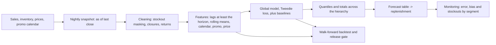

# Design 7: demand forecasting per item and store

**Prompt**: "A retailer with 1,000 stores wants a daily forecast of units sold for every item in every store for the
next 28 days, to drive replenishment orders." (Design 2 puts a copilot on top of models like these.)

## 1. Clarify (assumed answers)

- 1,000 stores, 50,000 products, about 20,000 carried per store: about 20 M store-item series.
- Daily grain, horizon 1-28 days. Order lead times are 2-14 days.
- A nightly batch after sales close; forecasts ready by 6 am.
- Ordering needs uncertainty, not only a number: a median (P50) and a high quantile (P90) for safety stock.
- Known future inputs: promotion calendar, planned prices, holidays, store openings. Unknown: competitors.

## 2. Requirements and estimates

- Functional: store-item-day forecasts with quantiles, totals for category and region that match the item level, and
  a promotion effect planners can read.
- Non-functional: the batch fits in 4 hours, every run is reproducible (data snapshot plus model version), and no model
  goes live without a backtest that beats the baselines.
- Output (estimate): 20 M series x 28 days = 560 M rows a night; with P50 and P90, about 1.1 B numbers, about 4.5 GB
  raw at 4 bytes each.
- History (estimate): 20 M series x 3 years x 365 days = about 22 B store-item-days. Most are zero, so store only
  non-zero sales plus a calendar.
- Compute (estimate): one global model trains on a sample of rows; scoring 560 M rows is a distributed batch job of a
  few hours on a modest cluster.

## 3. Data

- Sales (units per store-item-day), prices, promotions (type, depth, display), inventory and stockout flags, the
  product hierarchy (item, subcategory, category, department), store facts, and a calendar (holidays, paydays,
  school breaks).
- **Sales are not demand.** When the shelf is empty, sales are zero but demand was not. Mask stockout days from the
  training target, or estimate the lost sales. Otherwise the model learns to forecast low, which causes more
  stockouts: a feedback loop.
- **Intermittent demand**: most store-item-days are zero for slow movers. Percentage errors explode, and normal
  regression losses fit the zeros badly.
- **New items** have no history. Use item attributes and similar items, or forecast a level up and split down.

## 4. Boxes

## 5. Deep dive: hierarchy and intermittent demand

- **Global, not local**: 20 M separate time-series models are slow to run and cannot learn from neighbours. One
  gradient-boosted model over all series learns shared patterns (a promotion effect in a category) and copes with
  short histories. Series-level features (mean, share of zero days) let it specialise.
- **Loss for counts**: a Tweedie or Poisson loss fits many zeros and a long right tail. Keep a Croston-type method
  as the baseline for very slow movers.
- **Hierarchy**: totals must add up, or planners stop trusting both numbers. Bottom-up (sum the item forecasts) is
  consistent but noisy; top-down (split totals by history) is smooth but misses local patterns; reconciliation
  forecasts every level and adjusts them to add up. v1: bottom-up, plus an alert when the sum drifts away from a
  top-level model.
- **Quantiles do not add up.** The sum of daily P90s is not the P90 of the lead-time total. Safety stock needs the
  quantile of demand over the lead time, so model that directly or simulate it.

## 6. Deep dive: walk-forward backtesting and leakage traps

- **Walk-forward (rolling origin)**: pick an origin date, train on data before it, forecast the next 28 days, move
  the origin a week, repeat. Cover a full year of origins, so holidays and seasons are tested. Score each horizon
  separately.
- **Purge**: drop training rows whose target window reaches into the test period. In
  [volatility-regime-ml](https://github.com/Avinash186200/volatility-regime-ml), a different domain, the walk-forward
  refits every 63 days on a 1,000-day window over 32 folds, and drops those rows before every test block.
- **Leakage traps**:
  1. Lags shorter than the horizon. "Sales yesterday" is not known when forecasting day 14. Use lags of at least the
     horizon, or one model per horizon bucket.
  2. Promotions and prices as executed, not as planned at the origin.
  3. Actual weather instead of the weather forecast that existed at the origin.
  4. Encodings or scalers fitted on the full history.
  5. Inventory loaded days late but stamped with the sales date. Join on the date it was known.
- **Tuning on the backtest inflates it.** In
  [walk-forward-backtest-pipeline](https://github.com/Avinash186200/walk-forward-backtest-pipeline) (choosing trading
  strategies, not forecasts), the monthly picks scored an average in-sample Sharpe of 1.35 and earned 0.36 the next
  month. The best of many always looks better than it will be. Keep a final holdout period that no choice touched.
- **Fair baselines**: the same target and the same days for every model. In volatility-regime-ml, the old starter
  code scored its naive baseline on days shifted by one from the main model, so its "beats naive by about 22%" was not
  like-for-like.

## 7. Evaluation: baselines and error metrics

- **Baselines**: seasonal naive (same weekday last week), the mean of the last four same weekdays, Croston for slow
  movers. A model must beat them at each horizon and on each segment that matters.
- **MAPE** divides by actual sales. Zero-sales days break it, and small sales blow it up. Avoid it here.
- **WAPE** = sum of absolute errors / sum of actuals. Volume-weighted, works with zeros, easy to explain.
- **MASE** scales the error by the seasonal-naive error. Below 1 beats naive, and it compares across series.
- **Bias** = sum of errors / sum of actuals, tracked apart from accuracy. Over-forecast is waste; under-forecast is
  empty shelves.
- **Quantiles**: pinball loss, and coverage (does P90 cover about 90% of actuals?).
- **Business**: stockout rate, waste on perishables, days of inventory. The forecast exists to move these.
- Break every number down by fast and slow movers, promotion days, new items, and horizon.

## 8. Promotions and stockouts

- Promotion features: type, discount depth, display, advertising. Model the dip after a promotion (people stocked up)
  and cannibalisation (a promoted item takes sales from its siblings).
- Score promotion days on their own. Errors are largest there and the money is too.
- Flag series with frequent stockouts. Their history understates demand, and replenishment from a low forecast keeps
  them empty.

## 9. Failure modes

- **A moving holiday** (dates shift each year): "same day last year" is wrong. Use holiday features.
- **A missing feed**: a store's sales do not arrive, the zeros look real, and orders drop. Treat missing as missing,
  and check store totals before training.
- **A changed promotion plan** after the run: re-forecast the affected items when the plan changes.
- **Structural breaks** (a store refit, a new competitor nearby): watch bias per store, and allow planner overrides
  with an expiry date.
- **An over-tuned model**: wins the backtest it was tuned on, loses live. The untouched holdout catches it.

## 10. Trade-offs and v1

- v1: a global gradient-boosted model with Tweedie loss, lags of at least the horizon (one model per bucket: days 1-7,
  8-14, 15-28), promotion and calendar features, seasonal-naive and Croston baselines, bottom-up totals, P50 and P90,
  stockout masking, and a year of weekly walk-forward origins with a gate (beat the baselines on WAPE, bias inside a
  band, on each major segment).
- Later: reconciliation across levels, lost-sales estimates, a cannibalisation model, weather forecasts.
- Biggest trade-off: one global model is simpler to run and learns across items; per-category models may fit better
  but multiply what you must monitor. Trees with good features are a strong first choice for retail tables.

## What most candidates miss

- Sales are not demand. Stockouts censor the target.
- Lag features must respect the horizon.
- With zeros, use WAPE or MASE, not MAPE, and track bias apart from accuracy.
- Quantiles do not add up across days or items.
- A backtest that was tuned on is no longer a test. Keep a holdout.

## Likely probes

- "MAPE looks terrible on slow movers." MAPE divides by small or zero sales. Report WAPE and MASE, add bias, and judge
  slow movers against a Croston baseline, not against fast movers.
- "Why not one model per series?" 20 M models are slow to run and cannot share what they learn. A global model learns
  promotion and calendar effects across items and handles short histories.
- "How do you forecast a brand-new item?" Attributes and similar items in the global model, or a category forecast
  split by the shares of similar launches. Switch to its own history after a few weeks.
- "The model under-forecasts every promotion." Check that promotion features use the plan as of the origin, score
  promotion days on their own, and add depth and display features. Look for stockouts that capped past promotion sales.
- "Planners want store totals to equal the sum of the items." Forecast bottom-up, or reconcile every level so the
  numbers add up, and alert when a total drifts from a top-level model.
- "How do you know the backtest is honest?" Many weekly origins over a full year, lags at least the horizon, inputs as
  known at each origin, the same days for every baseline, and a final holdout that no tuning touched.
