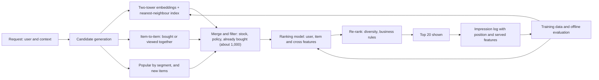

# Design 8: recommendations with retrieval and ranking

**Prompt**: "An online store with 10 M products wants a personalised 'recommended for you' row on its home page:
20 items per user, in under 200 ms."

## 1. Clarify (assumed answers)

- 10 M daily active users, about 5 home-page views each: 50 M requests a day.
- Catalog: 10 M items, about 100,000 new ones a day; items go out of stock.
- Latency: 200 ms at p99 for the recommendation call.
- Goal: purchases and return visits, not only clicks. Guardrails: no out-of-stock or restricted items, some
  diversity, and returns (a purchase sent back is not a win).

## 2. Requirements and estimates

- Functional: 20 ranked items per request, filtered for stock and policy, with impressions logged.
- Non-functional: p99 under 200 ms, the same features in training and serving, and every model judged in an A/B test
  before full launch.
- RPS (estimate): 50 M / 86,400 = about 580 on average; x5 at peak = about 3,000.
- **Why two stages** (estimate): scoring all 10 M items with a heavy model is 3,000 x 10 M = 30 B scores a second.
  Retrieval cuts that to about 1,000 candidates, so ranking does 3,000 x 1,000 = 3 M scores a second, spread over a
  few dozen servers.
- Latency budget (estimate): retrieval 20-30 ms (sources in parallel), feature reads 20-30 ms, ranking 30-50 ms,
  re-ranking rules 5-10 ms, the rest network and headroom.
- Storage (estimate): item embeddings 10 M x 128 dims x 4 bytes = about 5 GB, so the index fits in memory and is
  replicated. Impression log: 50 M requests x 20 items = 1 B impressions a day, about 200 GB at 200 bytes each.

## 3. Data and labels

- Interactions: impressions (what was shown, at which position), clicks, add-to-cart, purchases, returns.
- **Log impressions, not only clicks.** Shown-but-not-clicked items are the real negatives, and position is needed to
  correct position bias. Without the impression log, neither is possible.
- Labels arrive at different speeds: clicks in seconds (noisy), purchases in hours or days (rare), returns in weeks.
- Item data: title, category, price, images. User data: history, location, device. Context: time, page, referrer.

## 4. Boxes

## 5. Deep dive: candidate generation

- **Goal: recall, cheaply.** Several sources, merged: a two-tower model (a user tower and an item tower trained so
  their dot product predicts engagement) served from an approximate nearest-neighbour index; item-to-item
  co-occurrence; popular items by segment; and fresh items for exploration.
- **Measure recall@k of the candidate set**: of the items a user later engaged with, how many were in the 1,000?
  Ranking cannot rescue an item that retrieval dropped.
- **Two stages split the work**: the first stage must find the item, the second must order it. In
  [rag-evaluation-benchmark](https://github.com/Avinash186200/rag-evaluation-benchmark) (document search, the same
  two-stage shape), adding a cross-encoder reranker took BM25's MRR from 0.573 to 0.964, and after reranking BM25,
  dense and hybrid retrieval all ended at 0.964. The reranker cost about 200 ms per query on CPU, against under 10 ms
  without it. A strong second stage makes first-stage order matter less, but it can only reorder what it is given,
  and it is where the latency goes.

## 6. Deep dive: the ranking model

- Features: user history aggregates, item facts (price, category, popularity, age), cross features (the user's
  affinity to this category, price against the user's usual price), and context.
- v1 model: gradient-boosted trees with a ranking loss, or a pointwise click model. Later: a deep multi-task model
  with heads for click, add-to-cart and purchase.
- Final score: a weighted mix, for example p(purchase) x margin + w x p(click), with w set by experiments. When you
  multiply or add probabilities, they must be calibrated.
- Training rows: impressions with their labels. Downsample negatives for speed, and correct the probabilities after.

## 7. Evaluation: offline metrics against online A/B tests

- **Offline**: recall@k for retrieval; NDCG@k and MRR for ranking; log loss and calibration for the click model.
  Always on a later time window. A random split leaks future interactions.
- **Recall is not order.** In the same benchmark, BM25 had recall@5 of 0.898 but MRR of 0.573. The right item was
  usually in the list, but not near the top, and the top is what users see.
- **Offline data is biased**: logs only hold what the old model chose to show. A new model that likes items the old
  one never showed has no labels for them, so offline metrics favour models that copy the old one.
- **Corrections**: log the probability of each item being shown, keep a little randomisation, and weight by inverse
  propensity. Interleaving gives a fast online comparison before a full A/B test.
- **A/B test**: one primary metric (purchases per user), guardrails (latency, return rate, diversity), at least two
  weeks so novelty wears off, and a long-running holdout for retention.
- A gap between offline and online is normal. Offline is the filter; online is the judge.

## 8. Position bias, cold start, feedback loops

- **Position bias**: the top slot gets clicks because it is the top slot. Raw clicks teach "whatever was on top is
  good". Add position as a training feature and fix it to one value at serving, or estimate how often each position
  is looked at (from small random swaps) and weight clicks by the inverse.
- **Cold-start items**: content features (text and image embeddings) in the item tower give a new item a vector on day
  one. Reserve a few slots for new items, with a boost that fades as data arrives.
- **Cold-start users**: popular items by segment, context (location, device, referrer), and onboarding choices. Switch
  to personal results after a few interactions.
- **Feedback loop**: the model shows what it likes, only those items earn clicks, and the next model likes them more.
  The long tail starves. Fixes: a small exploration share, diversity rules, propensity logging, and a catalog
  coverage metric (share of items shown at least once a week).

## 9. Failure modes

- **Train-serve skew**: features computed differently online. Train on logged served features.
- **Stale index**: new items missing, sold-out items shown. Rebuild on a schedule and filter stock in real time.
- **Clickbait drift**: clicks rise, purchases fall, returns rise. Guardrails in every A/B test.
- **Popularity collapse**: catalog coverage falls week after week. Alert on it.
- **Offline leakage**: item popularity computed over a window that includes the test period.

## 10. Trade-offs and v1

- v1: two retrieval sources (item-to-item and popular by segment), a gradient-boosted ranker on logged features,
  simple re-rank rules (stock, policy, at most three items per category), impression logging with position, a 5%
  exploration share, and A/B tests with guardrails.
- Later: two-tower retrieval with content features, a multi-task ranker, position-bias correction, interleaving.
- Biggest trade-off: more candidates raise recall but cost ranking time; a deeper ranker is more accurate but harder to
  fit in 200 ms, so distil it or cache user features.

## What most candidates miss

- Impressions and positions must be logged, or there are no negatives and no bias correction.
- Offline metrics are computed on the old model's choices, so they favour models like it.
- Candidate recall caps everything downstream.
- Clicks are a proxy. Purchases are the goal, and returns are a guardrail.
- Exploration is a requirement, not a nice-to-have.

## Likely probes

- "Offline NDCG went up but the A/B test was flat." Offline data comes from the old model's choices and clicks are a
  proxy. Check for position bias and novelty effects, and check whether the gain sits in slots users never see.
- "Why two stages?" Scoring 10 M items per request with a heavy model is far too slow. A cheap first stage finds about
  1,000 candidates with high recall; an expensive second stage orders them.
- "How do you rank a brand-new item?" Content embeddings give it a vector on day one. Reserve exploration slots and let
  a boost fade as clicks arrive.
- "How do you remove position bias?" Position as a feature in training, fixed at serving. Or estimate how often each
  slot is looked at with small random swaps, and weight clicks by the inverse.
- "Everyone sees the same popular items." A feedback loop. Add exploration, diversity rules and propensity logging,
  and track catalog coverage.
- "How big should the candidate set be?" Plot candidate recall and ranking latency against k. Stop where recall
  flattens or the latency budget runs out.
